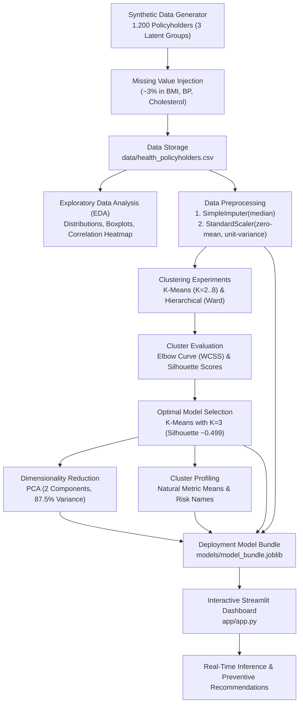

# Patient Health Risk Segmentation – Comprehensive Project Documentation

> **Project Title**: Patient Health Risk Segmentation Using Unsupervised Machine Learning  
> **Workspace**: `/Patient_Health_Risk_Segmentation`  
> **Target Audience**: Data Scientists, ML Engineers, Healthcare Actuaries, Clinical Informaticians, Students, and Evaluators  
> **Primary ML Algorithms**: K-Means Clustering, Agglomerative Hierarchical Clustering (Ward Linkage), Principal Component Analysis (PCA)  
> **Interface & Deployment**: Interactive Streamlit Web Application  
> **Dataset**: 1,200 Synthetic Health Insurance Policyholder Profiles  

---

## Table of Contents
1. [Executive Summary & System Architecture](#1-executive-summary--system-architecture)
2. [Workspace Directory & File Breakdown](#2-workspace-directory--file-breakdown)
3. [Clinical & Actuarial Features (Definitions & Ranges)](#3-clinical--actuarial-features-definitions--ranges)
4. [Data Simulation & Preprocessing Pipeline](#4-data-simulation--preprocessing-pipeline)
5. [Machine Learning Algorithms & Mathematical Foundations](#5-machine-learning-algorithms--mathematical-foundations)
6. [Evaluation Metrics & Optimal Cluster Selection](#6-evaluation-metrics--optimal-cluster-selection)
7. [Cluster Profiles & Preventive Healthcare Logic](#7-cluster-profiles--preventive-healthcare-logic)
8. [Libraries, Modules & Dependencies (Detailed Definitions)](#8-libraries-modules--dependencies-detailed-definitions)
9. [Streamlit Web Application Architecture](#9-streamlit-web-application-architecture)
10. [Model Persistence & Artifact Bundle Specification](#10-model-persistence--artifact-bundle-specification)
11. [Ethical Considerations, Clinical Disclaimers & Governance](#11-ethical-considerations-clinical-disclaimers--governance)

---

## 1. Executive Summary & System Architecture

### 1.1 Project Overview
The **Patient Health Risk Segmentation** system is an end-to-end unsupervised machine learning solution engineered to group health insurance policyholders into distinct, clinically meaningful health indicator segments. By identifying natural groupings without historical outcome labels, healthcare providers and health insurance wellness programmes can design proactive, tailored preventive health interventions (e.g., lifestyle coaching, biometric tracking, cardiovascular screenings) rather than reacting only after acute health events or costly insurance claims occur.

### 1.2 End-to-End Pipeline Workflow



---

## 2. Workspace Directory & File Breakdown

The repository follows a clean, modular, production-ready machine learning project structure:

```
Patient_Health_Risk_Segmentation/
├── app/
│   └── app.py                               # Production Streamlit Web Dashboard
├── data/
│   └── health_policyholders.csv             # Generated dataset (1,200 rows × 8 columns)
├── docs/
│   └── PROJECT_DOCUMENTATION.md             # Complete technical and domain documentation
├── models/
│   └── model_bundle.joblib                  # Serialized ML artifacts bundle for deployment
├── notebooks/
│   ├── Patient_Health_Risk_Segmentation.ipynb # Interactive, 73-cell reproducible notebook
│   └── analysis.py                          # Dedicated EDA automation script
├── reports/
│   ├── cluster_profiles.csv                 # Raw unscaled cluster averages + cluster sizes
│   ├── cluster_profiles_named.csv           # Cluster averages with mapped descriptive profile names
│   ├── cluster_sizes.csv                    # Member count and percentage per cluster
│   ├── methodology.md                       # High-level academic methodology overview
│   ├── model_metrics.csv                    # Empirical WCSS and Silhouette comparisons (K=2..8)
│   └── plots/                               # High-resolution (150 DPI) generated visual reports
│       ├── boxplots.png                     # Feature outlier & IQR boxplots
│       ├── correlation_heatmap.png          # Lower-triangle Spearman/Pearson correlation matrix
│       ├── dendrogram.png                   # Hierarchical clustering dendrogram (Ward linkage)
│       ├── distributions.png                # Multi-panel feature histograms
│       ├── elbow_curve.png                  # K-Means WCSS inertia curve marking optimal K
│       ├── pairplot.png                     # Pairwise bivariate scatter & KDE plots
│       ├── pca_clusters.png                 # 2D PCA projection with centroids
│       └── silhouette_curve.png             # Silhouette coefficient across K=2..8
├── requirements.txt                         # Pinned Python package dependencies
├── train_model.py                           # Master end-to-end training and artifact generation script
└── README.md                                # Project summary, quickstart guide & overview
```

### Detailed File Roles:

| File / Path | Type | Primary Role & Description |
|---|---|---|
| [`train_model.py`](file:///Users/payalkunwar/.gemini/antigravity-ide/scratch/Patient_Health_Risk_Segmentation/train_model.py) | Python Script | Master training orchestrator. Generates synthetic policyholders, introduces missingness, executes EDA, fits imputer, scaler, K-Means, Hierarchical clustering, PCA, computes cluster profiles, and exports all plots, tables, and serialized model bundle. |
| [`app/app.py`](file:///Users/payalkunwar/.gemini/antigravity-ide/scratch/Patient_Health_Risk_Segmentation/app/app.py) | Streamlit App | Interactive dashboard featuring custom healthcare dark-mode CSS, real-time risk group prediction form, dynamic radar/bar comparisons, tabular cluster exploration, model diagnostic plots, and clinical ethics guidance. |
| [`notebooks/analysis.py`](file:///Users/payalkunwar/.gemini/antigravity-ide/scratch/Patient_Health_Risk_Segmentation/notebooks/analysis.py) | Python Script | Standalone exploratory data analysis tool. Computes summary statistics, missing value audits, and saves core distribution, correlation, and boxplot visuals. |
| [`notebooks/Patient_Health_Risk_Segmentation.ipynb`](file:///Users/payalkunwar/.gemini/antigravity-ide/scratch/Patient_Health_Risk_Segmentation/notebooks/Patient_Health_Risk_Segmentation.ipynb) | Jupyter Notebook | Complete 35-step educational notebook detailing every research hypothesis, data visualization, algorithm step, mathematical justification, and deployment test. |
| [`data/health_policyholders.csv`](file:///Users/payalkunwar/.gemini/antigravity-ide/scratch/Patient_Health_Risk_Segmentation/data/health_policyholders.csv) | CSV Dataset | The primary tabular dataset containing 1,200 records across 8 attributes (ID + 7 features). |
| [`models/model_bundle.joblib`](file:///Users/payalkunwar/.gemini/antigravity-ide/scratch/Patient_Health_Risk_Segmentation/models/model_bundle.joblib) | Joblib Archive | Binary serialized dictionary packaging the fitted `KMeans`, `SimpleImputer`, `StandardScaler`, `PCA`, feature ordering, cluster profiles, and profile name mappings. |
| [`requirements.txt`](file:///Users/payalkunwar/.gemini/antigravity-ide/scratch/Patient_Health_Risk_Segmentation/requirements.txt) | Dependency Manifest | Pinned versions for reproducibility across virtual environments (`scikit-learn==1.5.1`, `pandas==2.2.2`, `streamlit==1.37.1`, etc.). |

---

## 3. Clinical & Actuarial Features (Definitions & Ranges)

The dataset contains seven physiological, lifestyle, and administrative features carefully selected to represent comprehensive cardiovascular, metabolic, and actuarial risk:

| Column Name | Data Type | Units / Format | Clinical & Actuarial Definition | Reference Standards & Health Significance |
|---|---|---|---|---|
| `policyholder_id` | String | `PH0001` - `PH1200` | Unique alphanumeric identifier for each insured individual. | Administrative key; excluded from model training to prevent arbitrary indexing bias. |
| `age` | Integer | Years ($18 - 85$) | Chronological age of the policyholder. | Primary non-modifiable risk factor for chronic cardiovascular, metabolic, and degenerative conditions. |
| `bmi` | Float | $\text{kg}/\text{m}^2$ ($16.0 - 45.0$) | **Body Mass Index**: Weight in kilograms divided by the square of height in meters ($\text{BMI} = \text{weight} / \text{height}^2$). | WHO classification: $<18.5$ Underweight; $18.5-24.9$ Normal; $25.0-29.9$ Overweight; $\ge 30.0$ Obese. High BMI strongly correlates with insulin resistance, hypertension, and dyslipidemia. |
| `systolic_bp` | Float / Int | $\text{mmHg}$ ($90 - 190$) | **Systolic Blood Pressure**: Peak arterial pressure exerted against vascular walls when the left ventricle contracts. | AHA/ACC Guidelines: Normal $<120$; Elevated $120-129$; Stage 1 Hypertension $130-139$; Stage 2 Hypertension $\ge 140$; Hypertensive Crisis $>180$. Key predictor of stroke and myocardial infarction. |
| `diastolic_bp` | Float / Int | $\text{mmHg}$ ($55 - 120$) | **Diastolic Blood Pressure**: Minimum arterial pressure exerted against vascular walls when the heart rests between beats. | AHA/ACC Guidelines: Normal $<80$; Stage 1 Hypertension $80-89$; Stage 2 Hypertension $\ge 90$. High diastolic pressure indicates elevated systemic vascular resistance. |
| `cholesterol` | Float / Int | $\text{mg}/\text{dL}$ ($115 - 330$) | **Total Serum Cholesterol**: Combined measurement of circulating HDL, LDL, and VLDL lipoproteins in the blood. | NCEP ATP III Guidelines: Desirable $<200$; Borderline high $200-239$; High $\ge 240\text{ mg/dL}$. Elevated circulating cholesterol drives atherosclerotic plaque accumulation in coronary arteries. |
| `physical_activity` | Float | Hours / Week ($0.0 - 12.0$) | Total weekly duration spent engaged in moderate-to-vigorous physical exercise. | CDC/WHO recommendation: $\ge 2.5\text{ to }5.0\text{ hrs/week}$. Protective lifestyle factor that elevates HDL, enhances insulin sensitivity, and lowers resting blood pressure. |
| `previous_claims` | Integer | Count ($0 - 12$) | Total number of formal insurance reimbursement claims filed in the preceding 3-year policy cycle. | Actuarial proxy for individual healthcare utilization frequency, past morbidity events, and ongoing disease management intensity. |

---

## 4. Data Simulation & Preprocessing Pipeline

### 4.1 Synthetic Data Generation Rationale
In real-world health applications, real patient electronic health records (EHR) and insurance claim files are strictly protected by privacy laws (HIPAA, GDPR) and proprietary insurance contracts. To provide an open, transparent, fully reproducible educational benchmark, synthetic data was programmatically synthesized using `numpy.random.default_rng(seed=42)`.

Three latent subpopulations were defined to simulate natural, clinically realistic clustering patterns without placing artificial hard borders:
1. **Group A (Lower-Indicator Profile, ~35%, n=420)**:
   - Young cohort ($\mu=30, \sigma=6$, clipped $18-48$)
   - Healthy BMI ($\mu=21.5, \sigma=2.2$), optimal BP ($110/70\text{ mmHg}$), optimal cholesterol ($\mu=165\text{ mg/dL}$)
   - High physical activity ($\mu=8.5\text{ hrs/week}$), rare claims ($\text{Poisson}(\lambda=0.8)$)
2. **Group B (Moderate-Indicator Profile, ~35%, n=420)**:
   - Middle-aged cohort ($\mu=49, \sigma=7$, clipped $34-64$)
   - Overweight BMI ($\mu=27.8, \sigma=2.4$), pre-hypertensive BP ($132/84\text{ mmHg}$), borderline cholesterol ($\mu=218\text{ mg/dL}$)
   - Moderate physical activity ($\mu=4.2\text{ hrs/week}$), occasional claims ($\text{Poisson}(\lambda=2.6)$)
3. **Group C (Higher-Indicator Profile, ~30%, n=360)**:
   - Senior cohort ($\mu=68, \sigma=7$, clipped $52-85$)
   - Obese BMI ($\mu=34.5, \sigma=3.2$), stage 2 hypertensive BP ($156/98\text{ mmHg}$), elevated cholesterol ($\mu=275\text{ mg/dL}$)
   - Low/sedentary activity ($\mu=1.2\text{ hrs/week}$), frequent claims ($\text{Poisson}(\lambda=6.2)$)

> **Important**: The latent group designations are strictly simulation mechanisms. They are dropped immediately; the ML algorithms only observe raw, unlabelled physiological measurements.

### 4.2 Missing Value Injection & Handling

- **Simulation**: In clinical practice, patients frequently miss lab screenings or omit biometric tests. Approximately **3.0% missing values (`NaN`)** were introduced at random across four biometric features: `bmi`, `systolic_bp`, `diastolic_bp`, and `cholesterol`.
- **Imputation Strategy**: `sklearn.impute.SimpleImputer(strategy="median")`.
  - **Why Median rather than Mean?** Biomedical distributions are frequently skewed by extreme physiological outliers. The median represents a non-parametric measure of central tendency that is robust to skewness.
  - **Leakage Prevention**: The imputer is fitted on the baseline training dataset. The identical fitted object is serialized into the deployment bundle so new individual policyholder inputs are imputed using the exact training median baseline.

### 4.3 Feature Standardization (`StandardScaler`)

- **Formula**: For each feature $j$ and value $x_{ij}$:
  $$z_{ij} = \frac{x_{ij} - \mu_j}{\sigma_j}$$
  where $\mu_j$ is the empirical feature mean and $\sigma_j$ is the feature standard deviation.
- **Why Scaling is Mandatory for Clustering**:
  Distance-based algorithms (such as K-Means and Hierarchical Clustering) compute distances in Euclidean space:
  $$d(p, q) = \sqrt{\sum_{k=1}^m (p_k - q_k)^2}$$
  If unscaled, a feature with large numerical values like `cholesterol` ($115 - 330\text{ mg/dL}$, variance $\approx 1600$) would completely dominate a feature with a small numerical range like `physical_activity` ($0 - 12\text{ hrs/wk}$, variance $\approx 9$) or `previous_claims` ($0 - 12$), rendering the smaller features statistically irrelevant. `StandardScaler` places all 7 dimensions on equal statistical footing with $\mu=0$ and $\sigma=1$.

---

## 5. Machine Learning Algorithms & Mathematical Foundations

### 5.1 K-Means Clustering (`sklearn.cluster.KMeans`)
- **Category**: Unsupervised Partitional / Centroid-Based Clustering.
- **Objective**: Partitions $N$ observations into $K$ non-overlapping Voronoi clusters $C = \{C_1, C_2, \dots, C_K\}$, minimizing the **Within-Cluster Sum of Squares (WCSS)** or **Inertia**:
  $$J = \sum_{k=1}^K \sum_{x_i \in C_k} ||x_i - \mu_k||^2$$
  where $\mu_k = \frac{1}{|C_k|} \sum_{x_i \in C_k} x_i$ is the mathematical centroid of cluster $C_k$.
- **Algorithm Iteration (Lloyd's Algorithm)**:
  1. *Initialization*: Place $K$ centroids randomly or via K-Means++ initialization.
  2. *Assignment*: Assign each sample $x_i$ to its nearest centroid: $C(i) = \arg\min_k ||x_i - \mu_k||^2$.
  3. *Update*: Recompute centroids $\mu_k$ as the mean of all points assigned to cluster $k$.
  4. *Convergence*: Repeat assignment and update until centroid drift falls below tolerance ($\epsilon = 10^{-4}$) or maximum iterations are reached.
- **Key Hyperparameters**:
  - `n_clusters=3`: Optimal number of partitions determined via elbow and silhouette analysis.
  - `n_init=20`: Runs the algorithm 20 separate times with different random centroid initializations and selects the lowest-inertia model. This protects against convergence to suboptimal local minima.
  - `random_state=42`: Ensures deterministic reproducibility.
- **Inference Capability**: K-Means provides direct, instant out-of-sample inference via `.predict()`. New unseen patient vectors are scaled and assigned to the nearest fitted cluster centroid in $\mathcal{O}(K \cdot D)$ time.

### 5.2 Agglomerative Hierarchical Clustering (`sklearn.cluster.AgglomerativeClustering`)
- **Category**: Unsupervised Bottom-Up Hierarchical Clustering.
- **Methodology**:
  - Starts with every sample in its own singleton cluster ($N$ clusters).
  - Sequentially merges the two clusters that result in the minimum increase in total within-cluster variance.
- **Linkage Criterion: Ward's Method (`linkage='ward'`)**:
  Ward minimizes the total within-cluster error sum of squares (ESS). The objective distance between two clusters $A$ and $B$ is:
  $$\Delta \text{ESS}_{AB} = \frac{n_A n_B}{n_A + n_B} ||\mu_A - \mu_B||^2$$
- **Role in Project**: Serves as an independent structural validation benchmark. Because Ward linkage also minimizes variance, it directly tests whether K-Means reached the true global cluster structure.
- **Deployment Limitation**: Standard agglomerative clustering builds an $\mathcal{O}(N^2)$ pairwise distance matrix and dendrogram tree; it lacks an out-of-sample `.predict()` method for scoring single new incoming patients without re-clustering the entire population. Hence, K-Means is deployed for production serving.

### 5.3 Principal Component Analysis (`sklearn.decomposition.PCA`)
- **Category**: Linear Dimensionality Reduction / Orthogonal Feature Projection.
- **Mathematical Rationale**:
  Finds an orthogonal transformation matrix $W$ that maps the 7-dimensional standardized data $X$ to an uncorrelated 2-dimensional space $Z = XW$:
  - First Principal Component ($PC1$): Vector maximizing sample variance $\text{Var}(z_1) = w_1^T \Sigma w_1$ subject to $||w_1||_2 = 1$.
  - Second Principal Component ($PC2$): Vector orthogonal to $PC1$ ($w_2^T w_1 = 0$) maximizing remaining variance.
- **Variance Explained in this Project**:
  - **PC1**: **81.95%** of total variance (predominantly capturing general age/metabolic cardiovascular load).
  - **PC2**: **5.55%** of total variance (capturing lifestyle variations, physical activity vs claim frequency).
  - **Total 2D Explained Variance**: **87.49%**.
- **Role**: Strictly used for visual cluster validation in 2D space. The clustering algorithms operate directly on the complete 7-dimensional standardized space to retain 100% of feature variance.

---

## 6. Evaluation Metrics & Optimal Cluster Selection

### 6.1 Evaluation Metrics

#### 1. Within-Cluster Sum of Squares (WCSS / Inertia)
Measures cluster compactness. While WCSS monotonically decreases as $K$ increases (approaching $0$ when $K=N$), the rate of decrease drops sharply at the "elbow" point, indicating that adding more clusters yields diminishing returns.

#### 2. Silhouette Coefficient ($s$)
Measures both cluster cohesion and cluster separation for each sample $i$:
$$s(i) = \frac{b(i) - a(i)}{\max(a(i), b(i))}$$
where:
- $a(i)$ = mean intra-cluster distance between sample $i$ and all other points in the same cluster.
- $b(i)$ = mean nearest-cluster distance between sample $i$ and points in the closest neighboring cluster.
- Score ranges from $-1.0$ (incorrect clustering) through $0.0$ (overlapping clusters) to $+1.0$ (dense, well-separated clusters).

### 6.2 Empirical Clustering Results Across $K = 2 \dots 8$

Data captured from [`reports/model_metrics.csv`](file:///Users/payalkunwar/.gemini/antigravity-ide/scratch/Patient_Health_Risk_Segmentation/reports/model_metrics.csv):

| Model | $K$ (Clusters) | WCSS (Inertia) | Silhouette Score | Selected? | Clinical Justification |
|---|---|---|---|---|---|
| K-Means | 2 | 2,752.68 | 0.4431 | No | Oversimplified; combines moderate patients with severe risks. |
| **K-Means** | **3** | **1,707.00** | **0.4987** | **YES** | **Sharp elbow bend; highest silhouette score for $K \le 5$; clear clinical low/moderate/high distinction.** |
| K-Means | 4 | 1,515.65 | 0.3807 | No | Significant drop in silhouette score; splits natural clusters artificially. |
| K-Means | 5 | 1,364.53 | 0.3477 | No | Low silhouette separation; diminishes clinical interpretability. |
| K-Means | 6 | 1,232.06 | 0.3204 | No | Over-segmentation; clusters become statistically fragile. |
| K-Means | 7 | 1,123.63 | 0.3207 | No | Over-segmentation; high model complexity. |
| K-Means | 8 | 1,029.07 | 0.3015 | No | Poor separation score; unstable boundaries. |
| **Hierarchical (Ward)** | **3** | *N/A* | **0.4985** | **Validation** | **Virtually identical silhouette score to K-Means, confirming global cluster stability.** |

---

## 7. Cluster Profiles & Preventive Healthcare Logic

### 7.1 Cluster Unscaling & Profiling Methodology
To make machine learning outputs interpretable to physicians, nurses, and insurance managers, the cluster means are converted back from standardized $z$-scores to their **original physical units** (years, $\text{kg}/\text{m}^2$, $\text{mmHg}$, $\text{mg/dL}$, hours/week, claim counts).

### 7.2 Composite Health Score & Dynamic Labeling
To prevent arbitrary cluster ID renumbering (where cluster 0 might be high-risk in one run and low-risk in another), clusters are dynamically ranked by a **Composite Indicator Score**:
$$\text{Composite Score} = \text{Age} + \text{BMI} + \text{Systolic BP} + \text{Cholesterol}$$
- The lowest composite score cluster receives the label: **"Lower-indicator profile"**
- The middle composite score cluster receives the label: **"Moderate-indicator profile"**
- The highest composite score cluster receives the label: **"Higher-indicator profile"**

### 7.3 Final Cluster Profiles Summary

| Metric | Cluster 0: Lower-indicator | Cluster 2: Moderate-indicator | Cluster 1: Higher-indicator | Population Reference |
|---|---|---|---|---|
| **Member Count** | 420 (35.0%) | 421 (35.1%) | 359 (29.9%) | 1,200 Total |
| **Mean Age** | **29.7 years** | **48.8 years** | **68.2 years** | $47.9$ years |
| **Mean BMI** | **21.6** (Normal) | **27.8** (Overweight) | **34.7** (Obese Class I/II) | $27.7\text{ kg/m}^2$ |
| **Systolic BP** | **110.1 mmHg** (Optimal) | **132.3 mmHg** (Prehypertension) | **156.4 mmHg** (Stage 2 HTN) | $131.7\text{ mmHg}$ |
| **Diastolic BP** | **70.1 mmHg** (Optimal) | **83.9 mmHg** (Prehypertension) | **98.2 mmHg** (Stage 2 HTN) | $83.4\text{ mmHg}$ |
| **Total Cholesterol**| **164.7 mg/dL** (Desirable) | **217.7 mg/dL** (Borderline High) | **275.4 mg/dL** (High) | $216.5\text{ mg/dL}$ |
| **Physical Activity**| **8.5 hrs/week** (Active) | **4.2 hrs/week** (Moderate) | **1.2 hrs/week** (Sedentary) | $4.8\text{ hrs/week}$ |
| **Past Claims** | **0.8 claims** (Minimal) | **2.6 claims** (Moderate) | **6.1 claims** (High utilization) | $3.0\text{ claims}$ |

### 7.4 Preventive Programme Recommendations

Based on the segmented profile, the application triggers targeted preventive recommendations:

```
┌────────────────────────────────────────────────────────────────────────┐
│ Lower-Indicator Profile (Maintenance & Primary Prevention)             │
│ • 🏃 Maintain current physical activity levels (>= 5 hrs/week)         │
│ • 🥗 Continue balanced nutrition and hydration habits                  │
│ • 🩺 Annual routine preventive wellness check-up                       │
│ • 🛡️ Baseline biometric monitoring (BP & lipid check every 2 years)   │
└────────────────────────────────────────────────────────────────────────┘

┌────────────────────────────────────────────────────────────────────────┐
│ Moderate-Indicator Profile (Targeted Lifestyle & Risk Reduction)       │
│ • 🏃 Increase aerobic activity to >= 150 minutes/week                  │
│ • 🥗 Dietary sodium restriction (< 2,300 mg/day) and DASH diet         │
│ • ⚖️ Structured weight management to lower BMI toward normal range     │
│ • 🩺 Semi-annual blood pressure and lipid profile monitoring           │
│ • 🧘 Stress reduction and sleep hygiene programmes                     │
└────────────────────────────────────────────────────────────────────────┘

┌────────────────────────────────────────────────────────────────────────┐
│ Higher-Indicator Profile (Clinical Intervention & Chronic Disease Mgmt)│
│ • 🩺 Comprehensive physician and cardiologist evaluation               │
│ • 💊 Adherence review for antihypertensive and lipid-lowering therapies│
│ • 🚶 Supervised, low-impact exercise regimen (walking, swimming)       │
│ • 📋 Frequent home BP tracking and quarterly clinical follow-up        │
│ • 🥗 Medically supervised medical nutrition therapy (MNT)              │
│ • 🤝 Dedicated chronic care management coordinator assignment          │
└────────────────────────────────────────────────────────────────────────┘
```

---

## 8. Libraries, Modules & Dependencies (Detailed Definitions)

Every tool and package in the codebase serves a distinct role:

### 8.1 Machine Learning & Core Computing

#### `scikit-learn` (`1.5.1`)
- **`sklearn.cluster.KMeans`**: Partitioning algorithm used for cluster training and real-time inference via nearest-centroid calculation.
- **`sklearn.cluster.AgglomerativeClustering`**: Hierarchical clustering baseline using Ward linkage for structural cluster validation.
- **`sklearn.decomposition.PCA`**: Computes principal components for project visualization without loss of multidimensional fidelity.
- **`sklearn.impute.SimpleImputer`**: Fills missing biomedical data points using column median values.
- **`sklearn.preprocessing.StandardScaler`**: Centers and normalizes features to zero mean and unit variance.
- **`sklearn.metrics.silhouette_score`**: Calculates cluster cohesion and separation coefficients across sample sets.

#### `scipy` (`1.13.1`)
- **`scipy.cluster.hierarchy.linkage`**: Computes the hierarchical agglomerative linkage matrix $Z$ containing cluster merge distances.
- **`scipy.cluster.hierarchy.dendrogram`**: Renders hierarchical tree structures, visualizing the distance threshold required to cut the tree into $K$ groups.

#### `numpy` (`1.26.4`)
- **`numpy.random.default_rng`**: High-performance, reproducible pseudo-random number generator utilizing the PCG64 bit generator.
- **`rng.normal`**: Draws random samples from Gaussian distributions to generate realistic biometric indicators.
- **`rng.poisson`**: Generates integer claim counts adhering to non-negative, discrete Poisson arrival processes.
- **`np.clip`**: Constrains simulated data values within biologically plausible human survival boundaries.

#### `pandas` (`2.2.2`)
- **`pd.DataFrame`**: High-performance tabular data structure providing data filtering, grouping, merging, and reshaping.
- **`df.groupby()`**: Aggregates records by cluster assignment to compute physical unscaled metric means.
- **`df.describe()`**: Computes distribution percentiles, standard deviations, and quartile ranges.

#### `joblib` (`1.4.2`)
- High-efficiency object serialization for NumPy arrays and scikit-learn estimators. Used by `joblib.dump()` and `joblib.load()` to serialize the trained ML pipeline bundle.

### 8.2 Data Visualization

#### `matplotlib` (`3.9.1`)
- Comprehensive plotting library. Utilizes the headless `Agg` backend (`matplotlib.use("Agg")`) in automated scripts to generate static PNG graphics without requiring a desktop window manager.

#### `seaborn` (`0.13.2`)
- Statistical graphics library built on top of Matplotlib. Used for masked triangular correlation heatmaps (`sns.heatmap`) and multi-variable pairplots (`sns.pairplot`).

### 8.3 Web Deployment & Introspection

#### `streamlit` (`1.37.1`)
- Pure-Python reactive web application framework. Powers the interactive dashboard with zero JavaScript boilerplate, providing session state, forms, sliders, column grids, tabs, and metric widgets.

#### `inspect` (Python Standard Library)
- Used in `app/app.py` to introspect `st.image` function signatures at runtime (`inspect.signature(st.image)`), ensuring compatibility between older Streamlit versions (`use_column_width`) and modern releases (`use_container_width`) without triggering IDE linter warnings.

---

## 9. Streamlit Web Application Architecture

The web application [`app/app.py`](file:///Users/payalkunwar/.gemini/antigravity-ide/scratch/Patient_Health_Risk_Segmentation/app/app.py) is organized into four interactive modules:

```
Streamlit Web Dashboard (app/app.py)
├── Sidebar
│   ├── Model Information (K-Means, K=3, PCA 2D, Seed 42)
│   ├── Educational & Clinical Disclaimers
│   └── Dataset Overview Metrics
└── Main Interface (4 Tabs)
    ├── Tab 1: 🔎 Prediction
    │   ├── Input Form (Age, BMI, Systolic BP, Diastolic BP, Cholesterol, Exercise, Claims)
    │   ├── Prediction Execution (Impute -> Scale -> KMeans.predict())
    │   ├── Color-Coded Result Banner (Green / Orange / Red)
    │   ├── Metric Comparison Cards (User vs Cluster Average)
    │   └── Tailored Preventive Health Programme Bullets
    ├── Tab 2: 📊 Cluster Profiles
    │   ├── Multi-Column Profile Summary Cards
    │   ├── Interactive Data Table (Cluster Means + Member Sizes)
    │   └── Standardized Z-Score Comparison Matrix
    ├── Tab 3: 📈 Model Analysis
    │   ├── Subtab A: Cluster Selection (Elbow Curve & Silhouette Curve)
    │   └── Subtab B: Visualizations (2D PCA Projection & Hierarchical Dendrogram)
    └── Tab 4: ℹ️ About the Project
        ├── Executive Summary & Motivation
        ├── Complete Data Pipeline Specification
        ├── Model Cards & Metrics Comparison
        └── Ethical & Regulatory Limitations
```

---

## 10. Model Persistence & Artifact Bundle Specification

To ensure total separation between training and inference, `train_model.py` bundles all deployment assets into a single portable binary file at `models/model_bundle.joblib`:

```python
bundle = {
    "model": km_model,  # Fitted sklearn.cluster.KMeans(n_clusters=3)
    "imputer": imputer,  # Fitted SimpleImputer(strategy='median')
    "scaler": scaler,  # Fitted StandardScaler()
    "pca": pca,  # Fitted PCA(n_components=2)
    "features": [  # Strict feature column ordering
        "age",
        "bmi",
        "systolic_bp",
        "diastolic_bp",
        "cholesterol",
        "physical_activity",
        "previous_claims",
    ],
    "selected_k": 3,  # Selected number of clusters
    "cluster_profiles": cluster_profiles,  # DataFrame of unscaled means + sizes
    "profile_name_map": profile_name_map,  # Dict: {0: 'Lower-indicator', ...}
    "seed": 42,  # Random seed for auditability
}
```

### Inference Lifecycle:
When a user submits health parameters in the web UI:
1. Input values are formatted into a single-row Pandas DataFrame matching `bundle['features']`.
2. Missing values (if any) are imputed via `bundle['imputer'].transform()`.
3. Biometrics are standardized via `bundle['scaler'].transform()`.
4. The cluster is predicted via `bundle['model'].predict(scaled_vector)`.
5. The cluster integer is mapped to its clinical label via `bundle['profile_name_map']`.
6. Values are compared against `bundle['cluster_profiles']` to produce real-time visual comparisons and preventive recommendations.

---

## 11. Ethical Considerations, Clinical Disclaimers & Governance

### 11.1 Academic & Educational Project Scope
- This project and all associated datasets are strictly **synthetic** and developed for **educational and research demonstrations**.
- The cluster assignments do **not** constitute medical diagnoses, clinical prognoses, formal risk stratification, or individual insurance underwriting determinations.

### 11.2 Prohibition of Punitive Insurance Applications
- **Underwriting & Premium Penalization**: Unsupervised clustering models must **never** be used in real-world insurance settings to unilaterally deny coverage, cancel policies, or impose punitive premiums on vulnerable or high-risk policyholders.
- **Ethical Use Case**: Algorithmic segmentation is strictly intended for **beneficent proactive care**—identifying individuals who would benefit from voluntary wellness coaching, subsidized blood pressure monitors, nutrition counseling, and preventive screenings.

### 11.3 Algorithmic Fairness, Bias & Privacy
- **Socioeconomic & Demographic Bias**: Real-world healthcare data contains historical inequities (e.g., disparities in healthcare access, diagnostic delays). Models trained on real claim histories can inherit systemic biases.
- **Privacy Protections**: Deployment in production environments requires compliance with healthcare data regulations including **HIPAA** (Health Insurance Portability and Accountability Act) in the United States and **GDPR** (General Data Protection Regulation) in the European Union, including strict encryption in transit and at rest, access logging, and anonymization.
